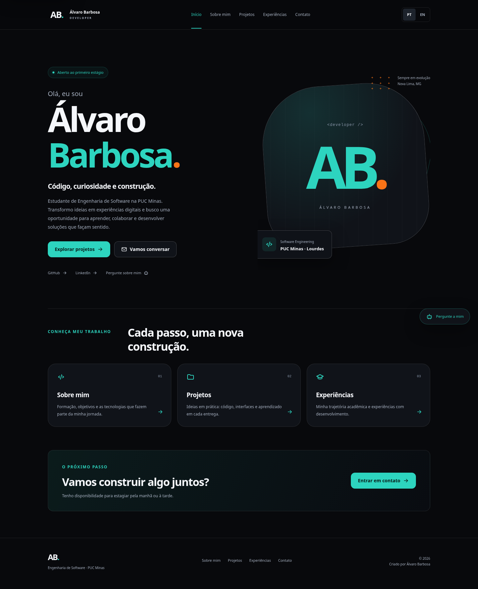
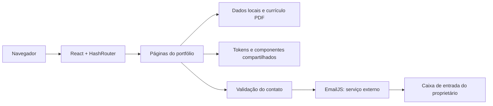
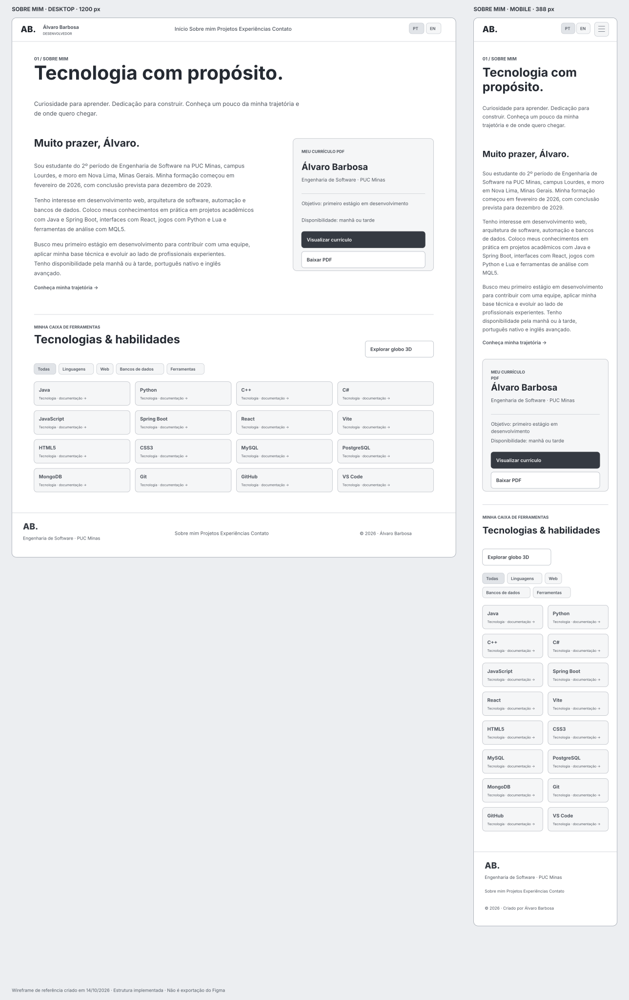
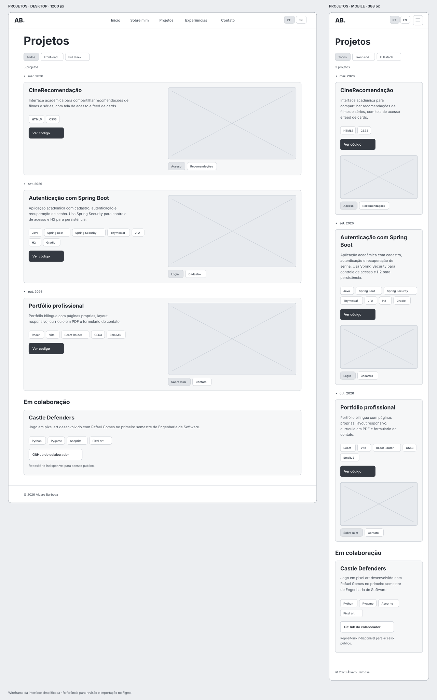
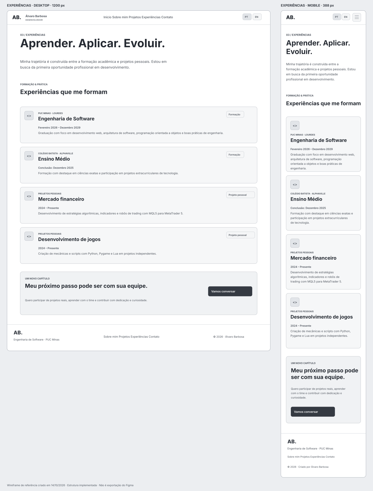
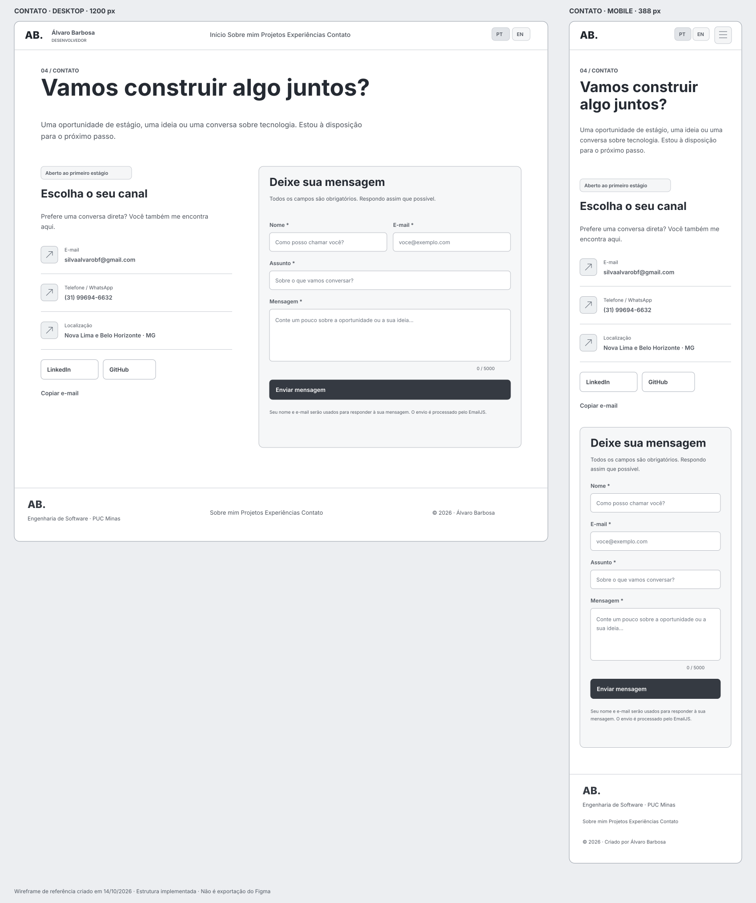
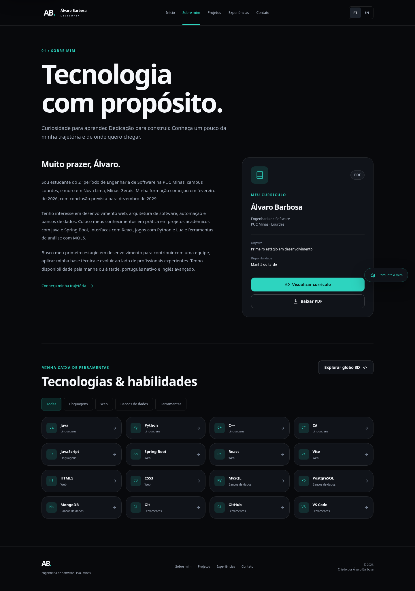
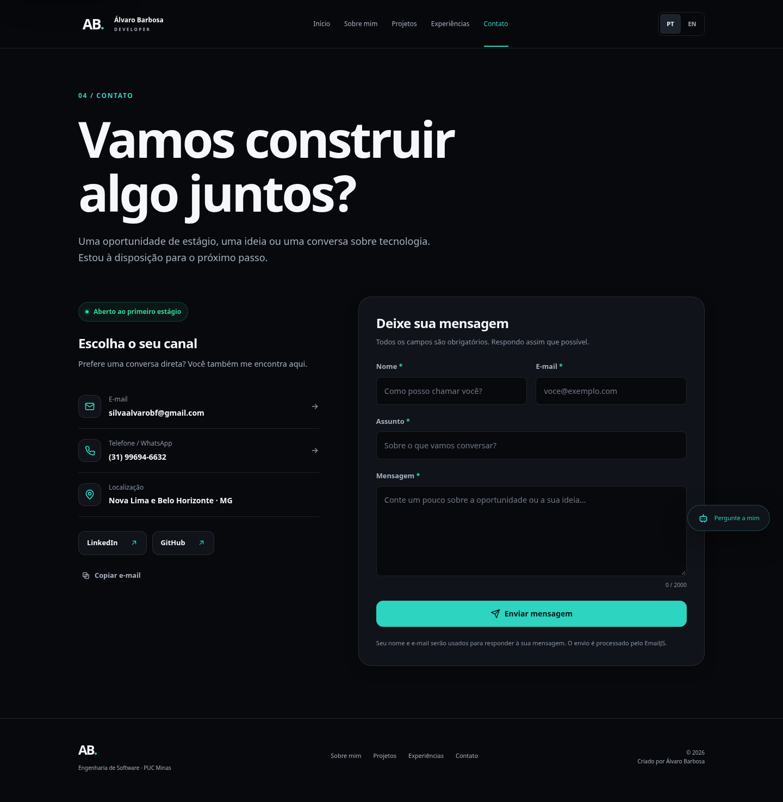
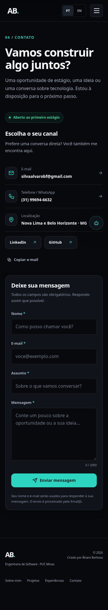

<!-- Adaptado do template de README do Prof. Dr. João Paulo Carneiro Aramuni. -->

# Portfólio profissional · Álvaro Barbosa

Portfólio bilíngue para apresentar minha formação em Engenharia de Software na PUC Minas, habilidades, projetos e canais de contato. Desenvolvido para o **Laboratório 01 de Desenvolvimento e Integração de Aplicações Web (DIAW)**, sob orientação do **Prof. Dr. João Paulo Carneiro Aramuni**.



## Status e links úteis

**Versão local validada.** Build, lint, 7 testes unitários e 17 testes de navegador passaram. O teste real autorizado do EmailJS retornou HTTP 200 — OK e o proprietário confirmou o recebimento. A correspondência com o arquivo Figma e a publicação da versão final ainda precisam das verificações descritas em [Evidências da atividade](docs/EVIDENCIAS.md).

- [Repositório](https://github.com/Alvarodocxp/Portifolio)
- [Figma informado para a atividade](https://www.figma.com/design/CWnq4BugBfnHdXvTuWFP3i/Sem-t%C3%ADtulo?node-id=0-1)
- [Design system](docs/DESIGN_SYSTEM.md) · [Wireframes de referência](docs/PROTOTIPOS.md)
- [Configuração do EmailJS](docs/EMAILJS.md)
- **Endereço previsto para GitHub Pages:** [alvarodocxp.github.io/Portifolio](https://alvarodocxp.github.io/Portifolio/). A disponibilidade da versão final nesse endereço não foi confirmada nesta tarefa; configurar e verificar a publicação antes da entrega.

## Sobre o projeto

O site reúne minha apresentação, objetivo profissional, currículo, tecnologias, trabalhos acadêmicos e experiências pessoais. O objetivo é facilitar o contato com recrutadores, colegas e avaliadores, com informação organizada e navegação acessível em computadores, tablets e celulares.

Busco meu primeiro estágio em desenvolvimento de software. Minha trajetória acadêmica e os trabalhos apresentados usam programação, desenvolvimento web, bancos de dados e automação. As experiências pessoais não são apresentadas como vínculos profissionais.

## Funcionalidades principais

| Página | Conteúdo |
| --- | --- |
| Início — `/#/` | Apresentação, disponibilidade, acesso aos projetos e canais sociais |
| Sobre mim — `/#/sobre` | Apresentação em português e inglês, formação, interesses, objetivo, currículo PDF e tecnologias com filtros |
| Projetos — `/#/projetos` | Timeline do mais antigo ao mais recente, filtros por área, descrição, stack, repositórios específicos e galerias de capturas reais |
| Experiências — `/#/experiencias` | Instituição, atividade, período e descrição de formação e projetos pessoais |
| Contato — `/#/contato` | E-mail, WhatsApp, LinkedIn e GitHub; formulário com validação, envio por EmailJS e estados de erro, envio e sucesso |

O menu troca a página exibida: cada rota possui conteúdo próprio, URL, título e estado ativo. O **HashRouter** permite abrir e atualizar rotas em hospedagem estática, inclusive GitHub Pages, sem regras especiais no servidor. O idioma escolhido é mantido na navegação e após recarregar a página.

O globo 3D de tecnologias é carregado somente quando solicitado. A lista de habilidades funciona sem WebGL. O assistente de currículo é complementar à atividade e tem respostas locais sem exigir chave de IA. Integração externa com Gemini não faz parte da validação desta entrega.

## Tecnologias, dependências e bibliotecas

| Tecnologia / pacote | Uso |
| --- | --- |
| JavaScript, JSX, HTML5 e CSS3 | Estrutura, comportamento e estilos |
| `react`, `react-dom` — React 19 | Componentes e renderização |
| `react-router-dom` — React Router 7 | Páginas, navegação e histórico |
| `vite` — Vite 8, `@vitejs/plugin-react` | Desenvolvimento e build de produção |
| `@emailjs/browser` — EmailJS 4 | Serviço externo de envio de e-mail |
| `three`, `@react-three/fiber`, `@react-three/drei` | Globo 3D opcional de tecnologias |
| `oxlint` | Análise estática |
| `@playwright/test` | Testes reais de navegador, responsividade e fluxos com API interceptada |
| `@types/react`, `@types/react-dom` | Tipagens utilizadas pelas ferramentas de desenvolvimento |

As versões instaláveis estão registradas em [package.json](package.json) e fixadas no [package-lock.json](package-lock.json). Fontes Inter, avatar GitHub e ícones do globo podem usar serviços externos; a fonte do sistema, o monograma e a lista textual oferecem alternativas locais.

## Arquitetura e design



O front-end é estático; o processamento de e-mail usa o serviço EmailJS e a conta conectada pelo proprietário. Não há banco de dados ou servidor próprio obrigatório para executar o portfólio. O formulário envia nome, endereço para resposta, assunto e mensagem; o destinatário permanece fixo no template da conta.

A identidade visual mantém o tema escuro original, superfícies slate, teal, azul e pequenos detalhes laranja. Cores, espaçamentos, tipografia, raios, estados e foco estão centralizados em [src/styles/design-system.css](src/styles/design-system.css) e documentados em [DESIGN_SYSTEM.md](docs/DESIGN_SYSTEM.md). Os layouts se ajustam em 380, 760, 820 e 1050 px conforme o componente, com medidas fluidas entre esses pontos.

As páginas têm landmarks semânticos, um `h1` por rota, labels nos campos, erros associados aos inputs, feedback acessível, navegação por teclado, foco visível, menu móvel com estado expandido e respeito a movimento reduzido. O diálogo do assistente contém o foco, fecha por Escape e devolve o foco ao botão de abertura.

### Planejamento e protótipos

Os wireframes abaixo foram produzidos como **referência da estrutura implementada**. São SVGs editáveis que podem ser importados no Figma. Não são exportações nem comprovação de acesso aos frames do arquivo Figma informado, que retornou bloqueio HTTP 403 neste ambiente. Para concluir a evidência da Sprint 01, revisar o arquivo compartilhado e incluir as exportações dos seus frames.

| Sobre mim | Projetos |
| --- | --- |
|  |  |
| Experiências | Contato |
|  |  |

## Instalação e execução

### Pré-requisitos

- **Node.js 24**, indicado em `.nvmrc`; validado com Node 24.19.0 e npm 11.9.0. Vite 8 exige pelo menos Node 20.19 ou 22.12; a recomendação antiga de Node 18 não se aplica.
- Git.
- Chromium para os testes de navegador. O build e os testes unitários não exigem navegador.

```bash
git clone https://github.com/Alvarodocxp/Portifolio.git
cd Portifolio
# Se utilizar nvm:
nvm install
nvm use
npm ci
npm run dev
```

Em um ambiente Codex já preparado, utilize o checkout existente. Cada tarefa já é isolada; não é necessário criar um Git worktree para começar.

### Configuração do contato

Crie `.env.local` a partir de `.env.example` e preencha os três campos com as configurações da sua própria conta EmailJS:

```env
VITE_EMAILJS_SERVICE_ID=
VITE_EMAILJS_TEMPLATE_ID=
VITE_EMAILJS_PUBLIC_KEY=
```

Use somente a **Public Key** apropriada para o navegador. Não inclua a Private Key em variáveis `VITE_*`. Reinicie o Vite depois de alterar as variáveis; em produção, refaça o build. `.env.local` é ignorado pelo Git. Consulte [EMAILJS.md](docs/EMAILJS.md) para configurar o template, Reply To, domínio e comprovar o recebimento.

O aplicativo pode ser desenvolvido sem esses valores, mas o envio pelo formulário exige uma configuração válida. Um link `mailto:` abre um rascunho no aplicativo de e-mail do visitante e não comprova que a mensagem foi enviada.

### Comandos disponíveis

```bash
npm run dev      # Servidor de desenvolvimento
npm run build    # Build estático em dist/
npm run preview  # Servir o build localmente
npm run lint     # Análise estática
npm test         # Testes unitários de contato
npm run test:e2e # Testes de navegador com API EmailJS simulada
```

Se Chromium não estiver instalado, prepare-o com `npx playwright install chromium`. Em Linux, a ferramenta usa `/usr/bin/chromium` quando presente. Outra instalação pode ser indicada com `PLAYWRIGHT_CHROMIUM_EXECUTABLE_PATH`. O teste E2E inicia o servidor ou reutiliza uma instância local e intercepta todas as chamadas EmailJS; não envia mensagens reais.

## Deploy gratuito

### GitHub Pages

O arquivo [.github/workflows/pages.yml](.github/workflows/pages.yml) prepara validação em pull requests e publicação da branch `main`, além de execução manual. A configuração está criada; nenhum push ou deploy remoto foi executado nesta tarefa.

1. No repositório GitHub, configure **Settings → Pages → Source → GitHub Actions**.
2. Em **Settings → Secrets and variables → Actions → Variables**, configure os três nomes `VITE_EMAILJS_*` acima. São identificadores e Public Key de um SDK de navegador. Não use uma Private Key.
3. Envie a versão revisada para `main` ou execute o workflow manualmente.
4. O workflow usa `npm ci`, lint, testes unitários e `npm run build -- --base=/Portifolio/`, e publica `dist/`.
5. Confirme o sucesso da execução e abra o endereço exibido pelo job de publicação. Atualize o status deste README após verificar página inicial, rotas internas, PDF e envio de e-mail no domínio publicado.

Para conferir o build com o mesmo caminho de publicação localmente:

```bash
npm run build -- --base=/Portifolio/
npm run preview -- --base=/Portifolio/
```

### Vercel

Como alternativa, importe o repositório na Vercel. [vercel.json](vercel.json) configura Vite, `npm run build` e saída `dist`. Adicione os três valores públicos do EmailJS nas variáveis de build e autorize a origem publicada no painel EmailJS. Não é necessário publicar em duas plataformas.

A publicação do **ambiente de desenvolvimento Codex** é independente da publicação do **website**; salvar o rascunho do ambiente não publica o site.

## Estrutura de diretórios

```text
Portifolio/
├── .github/workflows/pages.yml  # Validação e deploy GitHub Pages
├── docs/                       # Design, protótipos, EmailJS e evidências
├── public/
│   ├── media/                  # Capturas reais dos projetos e interface
│   ├── avatar-fallback.svg
│   └── curriculo-alvaro-barbosa.pdf
├── src/
│   ├── components/             # Ícones, assistente e globo 3D
│   ├── data/                   # Perfil, experiências e projetos
│   ├── lib/                    # Validação/envio e testes unitários
│   ├── pages/                  # Início, Sobre, Projetos, Experiências, Contato
│   ├── styles/design-system.css
│   ├── App.jsx                 # Rotas e estrutura compartilhada
│   └── main.jsx
├── tests/portfolio.spec.js     # Fluxos de navegador
├── playwright.config.js
├── package.json
├── package-lock.json
└── vite.config.js
```

## Demonstração e projetos

Capturas reais da aplicação em execução:

| Sobre mim | Contato |
| --- | --- |
|  |  |

<details>
<summary>Contato em celular (375 px)</summary>



</details>

A timeline apresenta CineRecomendação, autenticação com Spring Boot e este portfólio, com datas verificadas em commits e links específicos. As capturas do CineRecomendação vieram do próprio repositório; as telas do projeto Java foram capturadas com a aplicação real em execução. As fontes estão documentadas em [EVIDENCIAS.md](docs/EVIDENCIAS.md).

**Castle Defenders** aparece como colaboração com Python/Pygame. O repositório informado está privado conforme confirmado pelo aluno; o administrador precisa liberar o acesso para permitir consulta ao código e uma captura real do jogo. Trabalhos de MQL5 são descritos na experiência, sem prometer código público que não está disponível.

## Testes e evidências

- **7 testes unitários:** configuração, placeholders, campos inválidos, limites, parâmetros dos templates, resposta do serviço e erros.
- **17 testes Chromium:** 40 combinações de páginas/idiomas/larguras (320, 375, 768 e 1440 px), navegação e histórico, idioma persistente, timeline, galeria, validação, confirmação simulada, bloqueio de envio duplicado, falhas de rede/configuração/limite e teclado no diálogo.
- **Build e lint:** aprovados. O bundle 3D opcional ainda emite um aviso de tamanho; ele é carregado sob demanda.
- **Teste real EmailJS:** aceito com HTTP 200 — OK em 14/10/2026, usando o mesmo serviço, template e parâmetros do formulário, pela API REST com TLS verificado. Um único envio foi aceito. Os testes de interface usam respostas simuladas; o Chromium da nuvem não reconheceu o certificado do proxy nas chamadas externas. O proprietário confirmou no chat que recebeu a mensagem na caixa configurada no template.
- **Hospedagem pública:** pendente de execução do workflow e validação do domínio publicado.

## Processo de desenvolvimento e entrega

| Sprint | Valor | Entregas |
| --- | --- | --- |
| Lab01S01 | 4 pontos | Repositório, README, wireframes, protótipo, menu e layout; revisar os frames Figma e anexar as exportações |
| Lab01S02 | 4 pontos | Páginas bilíngues, timeline, experiências, contato, validação e responsividade; teste EmailJS aceito e recebimento confirmado pelo proprietário |
| Lab01S03 | 7 pontos | Capturas, acabamento e README preparados; publicar e testar a versão final |

Na apresentação, mostrar as páginas e os dois idiomas, filtros de projetos, capturas reais, currículo e mensagem recebida. Explicar a escolha do tema escuro, os tokens, a separação de páginas, as regras responsivas e o uso do EmailJS como serviço de e-mail. A conferência completa, com pendências identificadas, está em [EVIDENCIAS.md](docs/EVIDENCIAS.md).

## Documentações utilizadas

- [Template do professor](https://github.com/joaopauloaramuni/desenvolvimento-e-integracao-de-aplicacoes-web/blob/main/TEMPLATES/template_README.md)
- [React](https://react.dev/) · [Vite](https://vite.dev/) · [React Router](https://reactrouter.com/)
- [EmailJS](https://www.emailjs.com/docs/)
- [Playwright](https://playwright.dev/)
- [GitHub Pages](https://docs.github.com/en/pages) · [Vercel](https://vercel.com/docs)

## Autor, contribuição e agradecimentos

**Álvaro Barbosa** — Engenharia de Software, PUC Minas. [GitHub](https://github.com/Alvarodocxp) · [LinkedIn](https://www.linkedin.com/in/alvaro-barbosa).

Para contribuir, descreva o problema, preserve dados pessoais e nunca inclua credenciais privadas. Execute lint, testes e build antes de propor alterações. O Castle Defenders é identificado como trabalho colaborativo e o código pertence ao repositório informado do colaborador.

Agradecimentos ao Prof. Dr. João Paulo Carneiro Aramuni pelas orientações da disciplina e pelo template de documentação.

## Licença

Código deste repositório sob [licença MIT](LICENSE). As referências e capturas dos projetos vinculados mantêm a autoria e as condições de seus respectivos repositórios.
